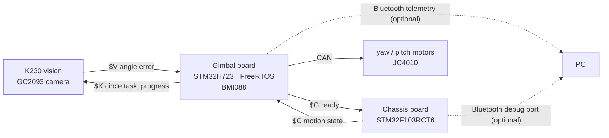

# Self-aiming laser on a line-following car (STM32 + K230)

[中文](README.md)

A practice build of problem E of the 2025 Chinese National Undergraduate Electronics Design Contest, ["simple self-aiming device"](https://nuedc.org/problems/2025_E%E9%A2%98_%E7%AE%80%E6%98%93%E8%87%AA%E8%A1%8C%E7%9E%84%E5%87%86%E8%A3%85%E7%BD%AE.pdf). A small car follows a 100 cm × 100 cm square black-line track counter-clockwise. A two-axis gimbal on the car carries a laser pointer and a camera, and while the car drives it either:

- **aims at the bullseye**: the laser stays on the centre of the target sheet, or
- **draws a circle** (advanced part 3): one lap of the car draws one circle of 6 cm radius on the target, in sync.

After power-up the car runs one lap on its own, with no remote control. Before it starts, the key on the chassis board (PB5) switches between the two tasks.

> This is a practice project. The contest requires a TI MSPM0 for line following and motor control; this chassis uses an STM32F103, so it does not meet the contest rules.

The documentation in `docs/`, `chassis/` and `vision/` is in Chinese; code comments are a mix of English and Chinese.

<!-- demo video: to be added -->

## Results

Field tests on 2026-10-29 to 31, practice target with a 315 × 233 mm outer frame, camera 0.5 to 1.7 m from the target. The error is what the K230 computes for every frame (predicted laser hit minus the aim point), converted to cm on the target face with the measured range (`tools/analysis/face_error_cm.py`, `circle_fit.py`). It is the system's own measurement and relies on the laser calibration; the spot on the paper was not measured.

| Run | Task | Time | Error on the face p50 | p99 | Max | Frames over 2 cm |
|---|---|---|---|---|---|---|
| final (10-29) | bullseye, 3 laps | 53.5 s | 0.39 cm | 1.30 cm | 1.75 cm | 0 |
| final2 (10-29) | bullseye, 3 laps | 53.5 s | 0.41 cm | 1.52 cm | 2.56 cm | 0.42 % |
| e100 (10-30) | bullseye, 1 lap | 18.4 s | 0.38 cm | 1.32 cm | 1.63 cm | 0 |
| t3a (10-31) | circle, 1 lap | 18.7 s | 0.34 cm | 2.26 cm | 2.41 cm | 1.8 % |
| t3b (10-31) | circle, 1 lap | 18.5 s | 0.53 cm | 1.86 cm | 2.33 cm | 0.9 % |

- 17.8 to 18.7 s per lap (the contest limit is 20 s).
- The largest single-frame angle error is 0.8 to 1.5°, always in a corner or within 2 s after one; every error above 1° comes right after a vision dropout, while the target is being re-acquired (`tools/analysis/worst_errors.py`).
- In the circle runs an offline fit finds a circular component in the gimbal bearing that follows the lap progress, with a horizontal amplitude of 68 / 74 mm (60 mm commanded, `circle_fit.py`).

## System



- **Chassis**: 8-channel grey-scale line following, encoder wheel-speed loops, ICM-40607 gz to measure each corner; counts 4 left turns per lap and stops back at the start. Every 20 ms it sends its motion state (turning or not, speed, gz, task, lap progress) to the gimbal.
- **Gimbal**: heated BMI088 with a Mahony attitude filter, speed control of the yaw and pitch motors. The vision error goes through a tracking filter into a rate command, plus vehicle-speed and chassis-turn feed-forward; during corners it holds its world direction and ignores vision. It forwards the chassis task and progress to the K230.
- **K230**: finds the black tape frame of the target in the grey image, fits sub-pixel corners, solves the target pose, intersects the calibrated laser ray with the target plane and computes the yaw / pitch error to the aim point (the bullseye, or the point on the circle for the current progress).

## Power-up sequence

1. Put the car on the line at the start with the target in view. Do not touch it after power-up: the gimbal IMU first heats to about 40 °C, then measures the gyro bias, about 14 s in total.
2. Once the chassis LED turns blue (IMU calibrated) and before the start, PB5 switches the task: 1 beep = bullseye, 2 beeps = circle. Wait at least 2 s after the last press.
3. When the gimbal is ready and vision has locked for 2 s, the gimbal reports `$G` ready; the chassis starts after standing still for 1 s, usually about 20 s after power-up.
4. One run per power-up; power-cycle or send `RUN` over Bluetooth for another. Any command on the chassis debug port before the start cancels the power-up run.

Details: [docs/GIMBAL_TUNING.md](docs/GIMBAL_TUNING.md), section 2.

## Hardware

| Part | Model / notes |
|---|---|
| Chassis MCU | STM32F103RCT6 (72 MHz) |
| Motor driver | TB6612, two PWM inputs per motor, about 80 kHz |
| Chassis motors | geared encoder motors, 13 lines × 30:1, differential drive |
| Line sensor | 8-channel multiplexed grey-scale module (3 address lines + 1 output) |
| Chassis IMU | ICM-40607 (gz only) |
| Gimbal MCU | DAMIAO DM-MC02 board (STM32H723VGT6, on-board heated BMI088) |
| Gimbal motors | 2 × JC4010, CAN, speed mode |
| Vision | Yahboom K230 vision module, GC2093 camera |
| Laser | laser pointer on the gimbal, next to the camera |
| Bluetooth | 2 serial Bluetooth modules, optional: gimbal telemetry, chassis debug |

## Board-to-board wiring

All boards share ground.

| Link | One end | Other end | Settings |
|---|---|---|---|
| vision → gimbal | K230 GPIO9 (UART1 TX) | gimbal PE2 (USART10 RX) | 921600 8N1 |
| gimbal → vision | gimbal PE3 (USART10 TX) | K230 GPIO10 (UART1 RX) | 921600 8N1, not needed for the bullseye task |
| chassis → gimbal | chassis PA2 (USART2 TX) | gimbal PA10 (USART1 RX) | 921600 8N1 |
| gimbal → chassis | gimbal PA9 (USART1 TX) | chassis PA3 (USART2 RX) | 921600 8N1 |
| gimbal Bluetooth | gimbal PE8 TX / PE7 RX (UART7) | Bluetooth module | 115200 |
| chassis Bluetooth | chassis PC12 TX / PD2 RX (UART5, header H4) | Bluetooth module | 115200 |
| gimbal motors | gimbal CAN1 / CAN2 | yaw / pitch motor | |

On-board pins (motors, encoders, IMU, line sensor, key) are in [chassis/AUTONOMOUS_CHASSIS.md](chassis/AUTONOMOUS_CHASSIS.md) and [docs/GIMBAL_TUNING.md](docs/GIMBAL_TUNING.md) section 1; frame formats, CRC and timeouts in [docs/GIMBAL_COMM_PROTOCOL.md](docs/GIMBAL_COMM_PROTOCOL.md).

## Layout

```text
chassis/           chassis firmware, Keil project MDK-ARM/ros_stm32.uvprojx
  User/            own code: Algorithm (mission state machine, protocol, power-up run...), App, Bsp
  Core/ Drivers/   CubeMX init code, ST HAL
  Tests/           chassis host tests and kinematic simulations
  host/            PC serial helpers, chassis log plots
gimbal/            gimbal firmware, Keil project MDK-ARM/CtrBoard-H7_ALL.uvprojx
  App/             gimbal control, IMU, protocol, telemetry, live tuning
  Bsp/ Algorithm/  board drivers (BMI088, CAN...), Mahony attitude filter
  Core/ Drivers/ Middlewares/ USB_DEVICE/   CubeMX code, ST HAL, FreeRTOS, USB
  tools/           telemetry recording and analysis (telemetry_log.py, run_report.py), control simulations
vision/            K230 program (MicroPython); deploy.ps1 builds the folder for the SD card
  tools/           camera and laser calibration, frame-log analysis
tests/             host tests (gimbal, protocol cross-checks, vision); run_tests.ps1 runs them all
tools/analysis/    offline analysis of lap logs
docs/              protocol, tuning manual, design notes
```

## Build and flash

**Chassis and gimbal firmware**

- Keil MDK 5 with ARM Compiler 5.06 update 7 (AC5). Recent MDK versions no longer ship AC5; install it separately.
- Packs: gimbal `Keil.STM32H7xx_DFP` 4.1.3, `ARM.CMSIS` 6.3.0, `ARM.CMSIS-DSP` 1.16.2; chassis `Keil.STM32F1xx_DFP` 2.4.1, `ARM.CMSIS` 4.5.0.
- Build the `.uvprojx` and download with an ST-Link (SWD). Command line (`UV4.exe` is in the `UV4/` folder of the Keil installation):

```bash
UV4.exe -b gimbal/MDK-ARM/CtrBoard-H7_ALL.uvprojx -j0 -o build.log
```

- All sources are UTF-8. Set Edit → Configuration → Editor → Encoding to UTF-8 without signature in Keil, or the Chinese comments show as mojibake.
- The chassis `.ioc` is not in sync with the sources: do not regenerate the project with CubeMX over it (see the end of `chassis/AUTONOMOUS_CHASSIS.md`).

**K230**

- Calibrate the camera and the laser first, which writes `vision/calibration.json` (see [vision/README.md](vision/README.md) section 4); without a valid calibration the K230 only sends invalid frames.
- Copy the program and the calibration to `k230_vision/` on the SD card (replace `E:\` with the SD card drive):

```bash
powershell -ExecutionPolicy Bypass -File vision/deploy.ps1 -Target E:\
```

- Start at power-up: copy the generated `autostart_main.py` to the SD card root and rename it to `main.py`.

## Tests

The host tests need no hardware; they use stand-ins and synthetic data and do not replace tests on the car. They need MSYS2 gcc (ucrt64, on PATH) and Python 3.

```bash
powershell -ExecutionPolicy Bypass -File tests/run_tests.ps1
```

The vision tests also need numpy and OpenCV (the camera calibration test needs OpenCV 5):

```bash
py -3.13 -m pip install -r vision/requirements-pc.txt
```

```bash
py -3.13 -B tests/test_vision.py
```

## Tuning and analysis

- Gimbal parameters (`tune_*`) can be changed live in the Keil Watch window or over Bluetooth; chassis parameters with `SET <name> <value>` over Bluetooth. Both live in RAM only and reset at power-up. See [docs/GIMBAL_TUNING.md](docs/GIMBAL_TUNING.md).
- Bluetooth telemetry: VOFA+ (JustFloat), or `gimbal/tools/telemetry_log.py` to record, analyse, or run a whole test with one command and save the parameters.
- After a run, the scripts in [tools/analysis/](tools/analysis/README.md) give lap time, error on the face, largest errors, corner-exit errors and the circle fit.

## Documentation (Chinese)

| Document | Contents |
|---|---|
| [docs/GIMBAL_TUNING.md](docs/GIMBAL_TUNING.md) | gimbal tuning and debugging: wiring, power-up, Keil Watch, live parameters, tuning procedure, telemetry, troubleshooting |
| [docs/GIMBAL_COMM_PROTOCOL.md](docs/GIMBAL_COMM_PROTOCOL.md) | serial protocol between the three boards: `$V` `$C` `$G` `$K` frames, CRC, sequence numbers, timeouts |
| [chassis/AUTONOMOUS_CHASSIS.md](chassis/AUTONOMOUS_CHASSIS.md) | chassis: wiring, defaults, debug commands, state machine and fault codes |
| [docs/CHASSIS_SCHEME.md](docs/CHASSIS_SCHEME.md) | chassis design (written before the implementation; the document above is current) |
| [vision/README.md](vision/README.md) | K230 program: deployment, wiring, detection and geometry, calibration, integration |
| [vision/CAMERA_CALIBRATION_REPORT.md](vision/CAMERA_CALIBRATION_REPORT.md) | camera and laser calibration record of this car |
| [docs/K230_VISION_SCHEME.md](docs/K230_VISION_SCHEME.md) | vision design (early; for target size and the circle task see vision/README.md) |
| [docs/examples/](docs/examples/) | protocol encoder examples (C / Python) |
| [tools/analysis/README.md](tools/analysis/README.md) | lap analysis scripts |

## Known limitations

- The accuracy above is computed by the K230 itself and depends on the laser calibration; the laser spot on the paper was not measured.
- In dim light (evening) the far target frame drops out more often. An adaptive threshold was tried and dropped: too slow on the board.
- Parameters are calibrated for this car and this practice track: corner trigger spacing `CHASSIS_EDGE_M`, wheel base and circumference, target height above the camera, vision latency and so on. A different car or track needs new values. The practice target is 315 × 233 mm; for the A4 contest target change `TARGET_*` in `vision/config.py`.
- There is no start marker: the stop position relies on odometry.

## License

This project is released under the [GPL-3.0](LICENSE). The gimbal firmware contains GPL code, `MahonyAHRS.c` (x-io Technologies, GNU GPL) and the BMI088 driver (adapted from the DJI RoboMaster development board C examples, GPL-3.0-or-later), so the project as a whole is GPL-3.0.

Third-party code keeps its own license:

| Code | Location | Source and license |
|---|---|---|
| STM32 HAL, CMSIS Device | `chassis/Drivers/`, `gimbal/Drivers/` | ST, BSD-3-Clause / Apache-2.0 |
| CMSIS Core | `*/Drivers/CMSIS/Include/` | Arm, Apache-2.0 |
| FreeRTOS | `gimbal/Middlewares/Third_Party/FreeRTOS/` | MIT |
| STM32 USB Device Library | `gimbal/Middlewares/ST/STM32_USB_Device_Library/` | ST SLA0044, for ST devices only, not covered by this project's GPL grant |
| Mahony AHRS | `gimbal/Algorithm/MahonyAHRS.c` | x-io Technologies (S. Madgwick), GNU GPL |
| BMI088 driver | `gimbal/Bsp/BMI088driver.c` | adapted from [RoboMaster/Development-Board-C-Examples](https://github.com/RoboMaster/Development-Board-C-Examples), GPL-3.0-or-later |
| Gimbal board examples | `gimbal/Bsp/` (LCD, W25Q64, WS2812, key, buzzer, CAN, BMI088Middleware), the key / lcd / fun_test tasks in `gimbal/App/` | DAMIAO DM-MC02 vendor examples |

## Acknowledgements

- Teammate kian: the first version of the gimbal control ([GGbond-dot/TIcar](https://github.com/GGbond-dot/TIcar)), which this project builds on.
- DAMIAO: the DM-MC02 gimbal control board and its examples.
- DJI RoboMaster: development board C examples.
- x-io Technologies / Sebastian Madgwick: the C implementation of the Mahony AHRS.
- Yahboom: K230 vision module documentation.
