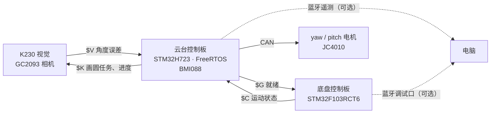

# 简易自行瞄准装置：巡线小车 + 激光云台 + K230 视觉

[English](README.en.md)

[2025 年全国大学生电子设计竞赛 E 题「简易自行瞄准装置」](https://nuedc.org/problems/2025_E%E9%A2%98_%E7%AE%80%E6%98%93%E8%87%AA%E8%A1%8C%E7%9E%84%E5%87%86%E8%A3%85%E7%BD%AE.pdf)的练习实现。小车沿 100 cm × 100 cm 的方形黑线赛道逆时针行驶，车上的二轴云台装着激光笔和摄像头，行驶中：

- **打靶心**：激光一直指向靶纸中心；
- **画圆**（发挥部分 (3)）：车跑 1 圈，激光在靶面上同步画 1 个半径 6 cm 的圆。

上电后自动跑 1 圈，全程不用遥控；出发前按底盘上的按键（PB5）在两个任务之间切换。

> 这是练习项目。赛题要求巡线和电机控制由 TI MSPM0 完成，本项目的底盘用的是 STM32F103，不符合比赛规则。

<!-- 演示视频：待补 -->

## 实测结果

2026-10-29～31 实车测试，练习靶外框 315 × 233 mm，相机到靶 0.5～1.7 m。误差是 K230 每帧算出的「预测激光落点 − 目标点」，按距离换算到靶面（`tools/analysis/face_error_cm.py`、`circle_fit.py`）。这是系统自己的测量（依赖激光标定），不是在靶纸上量的光斑位置。

| 跑圈 | 任务 | 用时 | 靶面误差 p50 | p99 | 最大 | 超过 2 cm 的帧 |
|---|---|---|---|---|---|---|
| final（10-29） | 打靶心，3 圈 | 53.5 s | 0.39 cm | 1.30 cm | 1.75 cm | 0 |
| final2（10-29） | 打靶心，3 圈 | 53.5 s | 0.41 cm | 1.52 cm | 2.56 cm | 0.42 % |
| e100（10-30） | 打靶心，1 圈 | 18.4 s | 0.38 cm | 1.32 cm | 1.63 cm | 0 |
| t3a（10-31） | 画圆，1 圈 | 18.7 s | 0.34 cm | 2.26 cm | 2.41 cm | 1.8 % |
| t3b（10-31） | 画圆，1 圈 | 18.5 s | 0.53 cm | 1.86 cm | 2.33 cm | 0.9 % |

- 每圈 17.8～18.7 s（赛题要求 ≤ 20 s）。
- 单帧角度误差最大 0.8～1.5°，都出现在弯里或出弯后 2 s 内；超过 1° 的几次都紧跟在视觉丢帧之后，是重新锁定的过程（`tools/analysis/worst_errors.py`）。
- 画圆时，离线拟合出云台方位里有和跑圈进度同步的圆周分量，水平幅度 68 / 74 mm（目标 60 mm，`circle_fit.py`）。

## 系统组成



- **底盘**：8 路灰度巡线，编码器轮速闭环，ICM-40607 的 gz 判断每个弯转了多少度；按 4 个左转弯计圈、回到起点停车。每 20 ms 把运动状态（是否在转弯、车速、gz、任务、跑圈进度）发给云台。
- **云台**：BMI088 恒温加热 + Mahony 姿态解算，yaw / pitch 两个电机速度控制。视觉误差经跟踪滤波变成角速度指令，叠加车速前馈和底盘转速前馈；转弯时保持世界方向、暂停视觉。底盘的任务和进度转发给 K230。
- **K230**：在灰度图里找靶纸的黑胶带框，拟合亚像素角点，求靶面位姿，用标定好的激光射线算出落点，再算到目标点（靶心，或圆上按进度走的点）的 yaw / pitch 误差。

## 上电流程

1. 车放在起点的线上，靶在相机视野里。上电后别碰车：云台 IMU 先加热到约 40 ℃，再测陀螺零偏，约 14 s。
2. 底盘蓝灯亮（IMU 校准完）之后、出发之前，按 PB5 切换任务：蜂鸣器响 1 声 = 打靶心，2 声 = 画圆。按完至少等 2 s。
3. 云台就绪、视觉稳定锁靶 2 s 后，云台发 `$G` 就绪；底盘静止 1 s 后自动出发，一般在上电后约 20 s。
4. 每次上电只跑一次，再跑就重新上电，或者用蓝牙发 `RUN`。出发前往底盘调试口发任何命令，都会取消这次自启动。

详见 [docs/GIMBAL_TUNING.md](docs/GIMBAL_TUNING.md) 第 2 节。

## 硬件

| 部分 | 型号 / 说明 |
|---|---|
| 底盘主控 | STM32F103RCT6（72 MHz） |
| 电机驱动 | TB6612，双 PWM 约 80 kHz |
| 底盘电机 | 编码器减速电机，13 线 × 30 减速比，两轮差速 |
| 巡线 | 8 路选通式灰度模块（3 根地址线 + 1 根输出） |
| 底盘 IMU | ICM-40607（只用 gz） |
| 云台主控 | 达妙 DM-MC02 开发板（STM32H723VGT6，板载带加热的 BMI088） |
| 云台电机 | 2 × JC4010，CAN 速度模式 |
| 视觉 | 亚博 K230 视觉模块，GC2093 相机 |
| 激光 | 激光笔，和相机一起装在云台上 |
| 蓝牙 | 2 个串口蓝牙模块，可选：云台遥测、底盘调试 |

## 板间接线

所有板子共地。

| 连接 | 一端 | 另一端 | 参数 |
|---|---|---|---|
| 视觉 → 云台 | K230 GPIO9（UART1 TX） | 云台 PE2（USART10 RX） | 921600 8N1 |
| 云台 → 视觉 | 云台 PE3（USART10 TX） | K230 GPIO10（UART1 RX） | 921600 8N1，只打靶心时可不接 |
| 底盘 → 云台 | 底盘 PA2（USART2 TX） | 云台 PA10（USART1 RX） | 921600 8N1 |
| 云台 → 底盘 | 云台 PA9（USART1 TX） | 底盘 PA3（USART2 RX） | 921600 8N1 |
| 云台蓝牙 | 云台 PE8 TX / PE7 RX（UART7） | 蓝牙模块 | 115200 |
| 底盘蓝牙 | 底盘 PC12 TX / PD2 RX（UART5，H4 接口） | 蓝牙模块 | 115200 |
| 云台电机 | 云台 CAN1 / CAN2 | yaw / pitch 电机 | |

板内引脚（电机、编码器、IMU、巡线、按键）见 [chassis/AUTONOMOUS_CHASSIS.md](chassis/AUTONOMOUS_CHASSIS.md) 和 [docs/GIMBAL_TUNING.md](docs/GIMBAL_TUNING.md) 第 1 节；帧格式、CRC 和超时规则见 [docs/GIMBAL_COMM_PROTOCOL.md](docs/GIMBAL_COMM_PROTOCOL.md)。

## 目录结构

```text
chassis/           底盘固件，Keil 工程 MDK-ARM/ros_stm32.uvprojx
  User/            自写代码：Algorithm（任务状态机、协议、自启动……）、App、Bsp
  Core/ Drivers/   CubeMX 生成的初始化代码、ST HAL
  Tests/           底盘主机测试和运动学仿真
  host/            电脑端串口工具、底盘日志画图
gimbal/            云台固件，Keil 工程 MDK-ARM/CtrBoard-H7_ALL.uvprojx
  App/             云台控制、IMU、协议、遥测、在线调参
  Bsp/ Algorithm/  板级驱动（BMI088、CAN……）、Mahony 姿态解算
  Core/ Drivers/ Middlewares/ USB_DEVICE/   CubeMX 生成代码、ST HAL、FreeRTOS、USB
  tools/           遥测记录与分析（telemetry_log.py、run_report.py）、控制仿真
vision/            K230 程序（MicroPython），deploy.ps1 生成 SD 卡上的部署目录
  tools/           相机和激光标定、帧日志分析
tests/             主机测试（云台、协议交叉校验、视觉），run_tests.ps1 一次跑完
tools/analysis/    跑圈日志离线分析
docs/              通信协议、调参手册、方案文档
```

## 编译与烧录

**底盘和云台固件**

- Keil MDK 5，编译器 ARM Compiler 5.06 update 7（AC5）。新版 MDK 不再自带 AC5，需要另外安装。
- 需要的 Pack：云台 `Keil.STM32H7xx_DFP` 4.1.3、`ARM.CMSIS` 6.3.0、`ARM.CMSIS-DSP` 1.16.2；底盘 `Keil.STM32F1xx_DFP` 2.4.1、`ARM.CMSIS` 4.5.0。
- 打开 `.uvprojx` 编译，用 ST-Link（SWD）下载。也可以命令行编译（`UV4.exe` 在 Keil 安装目录的 `UV4/` 下）：

```bash
UV4.exe -b gimbal/MDK-ARM/CtrBoard-H7_ALL.uvprojx -j0 -o build.log
```

- 源码都是 UTF-8。Keil 里把 Edit → Configuration → Editor → Encoding 设成 UTF-8 without signature，中文注释才不会显示成乱码。
- 底盘的 `.ioc` 没有和源码同步，不要直接用 CubeMX 重新生成覆盖（见 `chassis/AUTONOMOUS_CHASSIS.md` 末尾）。

**K230**

- 先做相机和激光标定，生成 `vision/calibration.json`（见 [vision/README.md](vision/README.md) 第 4 节）；没有有效标定时 K230 只发无效帧。
- 运行下面的命令（`E:\` 换成 SD 卡盘符），把程序和标定文件拷到 SD 卡的 `k230_vision/`：

```bash
powershell -ExecutionPolicy Bypass -File vision/deploy.ps1 -Target E:\
```

- 上电自启动：把生成的 `autostart_main.py` 拷到 SD 卡根目录，改名为 `main.py`。

## 测试

主机测试不需要硬件，用替身和合成数据，不能代替实车验证。需要 MSYS2 的 gcc（ucrt64，加到 PATH）和 Python 3。

```bash
powershell -ExecutionPolicy Bypass -File tests/run_tests.ps1
```

视觉测试另需 numpy 和 OpenCV（相机标定那一项要 OpenCV 5）：

```bash
py -3.13 -m pip install -r vision/requirements-pc.txt
```

```bash
py -3.13 -B tests/test_vision.py
```

## 调参与分析

- 云台参数（`tune_*`）可以用 Keil Watch 或蓝牙在线改，底盘参数用蓝牙 `SET <名字> <值>` 改，都只在 RAM 里，重新上电恢复默认。见 [docs/GIMBAL_TUNING.md](docs/GIMBAL_TUNING.md)。
- 蓝牙遥测用 VOFA+（JustFloat），或者 `gimbal/tools/telemetry_log.py`：记录、分析，或者一条命令跑完一次测试并保存参数。
- 跑完用 [tools/analysis/](tools/analysis/README.md) 的脚本分析：用时、靶面误差、最大误差、出弯误差、画圆拟合。

## 文档

| 文档 | 内容 |
|---|---|
| [docs/GIMBAL_TUNING.md](docs/GIMBAL_TUNING.md) | 云台调参与调试手册：接线、上电流程、Keil Watch、在线参数、调参流程、蓝牙遥测、常见问题 |
| [docs/GIMBAL_COMM_PROTOCOL.md](docs/GIMBAL_COMM_PROTOCOL.md) | 三块板之间的串口协议：`$V` `$C` `$G` `$K` 的帧格式、CRC、序号、超时 |
| [chassis/AUTONOMOUS_CHASSIS.md](chassis/AUTONOMOUS_CHASSIS.md) | 底盘：接线、默认参数、调试命令、状态机和故障码 |
| [docs/CHASSIS_SCHEME.md](docs/CHASSIS_SCHEME.md) | 底盘设计方案（开发前写的，现行实现以上一篇为准） |
| [vision/README.md](vision/README.md) | K230 程序：部署、接线、检测与几何、标定、联调 |
| [vision/CAMERA_CALIBRATION_REPORT.md](vision/CAMERA_CALIBRATION_REPORT.md) | 这台车的相机和激光标定记录 |
| [docs/K230_VISION_SCHEME.md](docs/K230_VISION_SCHEME.md) | 视觉方案设计（开发初期写的，靶面尺寸、画圆等以 vision/README.md 为准） |
| [docs/examples/](docs/examples/) | 协议编码示例（C / Python） |
| [tools/analysis/README.md](tools/analysis/README.md) | 跑圈分析脚本 |

## 已知限制

- 上面的精度是 K230 自己算的，依赖激光标定，没有在靶纸上实测光斑。
- 光线暗时（傍晚）远处的靶框容易丢帧。试过自适应阈值，板上太慢，没有采用。
- 参数是按这台车和这块练习场地标定的：拐角触发间距 `CHASSIS_EDGE_M`、轮距和轮周长、靶心比相机高多少、视觉延迟等，换车或换场地要重新标定。练习靶是 315 × 233 mm，比赛用 A4 靶要改 `vision/config.py` 的 `TARGET_*`。
- 底盘没有起点标记，停车位置靠里程计。

## 许可证

本项目按 [GPL-3.0](LICENSE) 发布。云台固件用到的 `MahonyAHRS.c`（x-io Technologies，GNU GPL）和 BMI088 驱动（改自 DJI RoboMaster 开发板 C 型例程，GPL-3.0-or-later）是 GPL 代码，所以整个项目用 GPL-3.0。

第三方代码保留各自的许可证：

| 代码 | 位置 | 来源与许可证 |
|---|---|---|
| STM32 HAL、CMSIS Device | `chassis/Drivers/`、`gimbal/Drivers/` | ST，BSD-3-Clause / Apache-2.0 |
| CMSIS Core | `*/Drivers/CMSIS/Include/` | Arm，Apache-2.0 |
| FreeRTOS | `gimbal/Middlewares/Third_Party/FreeRTOS/` | MIT |
| STM32 USB Device Library | `gimbal/Middlewares/ST/STM32_USB_Device_Library/` | ST SLA0044，只能用于 ST 的芯片，不在本项目的 GPL 授权范围内 |
| Mahony AHRS | `gimbal/Algorithm/MahonyAHRS.c` | x-io Technologies（S. Madgwick），GNU GPL |
| BMI088 驱动 | `gimbal/Bsp/BMI088driver.c` | 改自 [RoboMaster/Development-Board-C-Examples](https://github.com/RoboMaster/Development-Board-C-Examples)，GPL-3.0-or-later |
| 云台板例程 | `gimbal/Bsp/`（LCD、W25Q64、WS2812、按键、蜂鸣器、CAN、BMI088Middleware），`gimbal/App/` 的 key / lcd / fun_test 任务 | 达妙 DM-MC02 厂家例程 |

## 致谢

- 队友 kian：云台控制的最初版本（[GGbond-dot/TIcar](https://github.com/GGbond-dot/TIcar)），本项目在此基础上修改。
- 达妙科技：DM-MC02 云台控制板和例程。
- DJI RoboMaster：开发板 C 型例程。
- x-io Technologies / Sebastian Madgwick：Mahony AHRS 的 C 实现。
- 亚博智能：K230 视觉模块资料。
